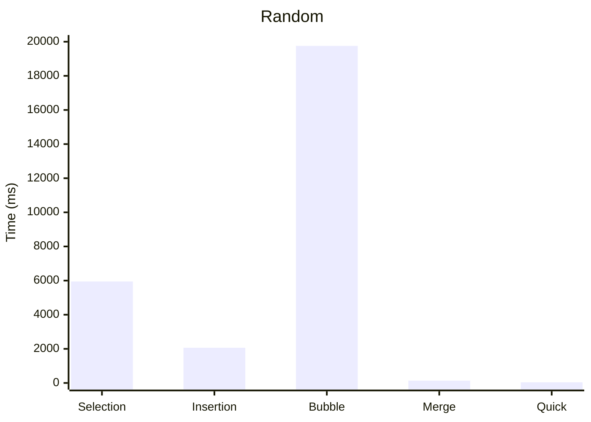
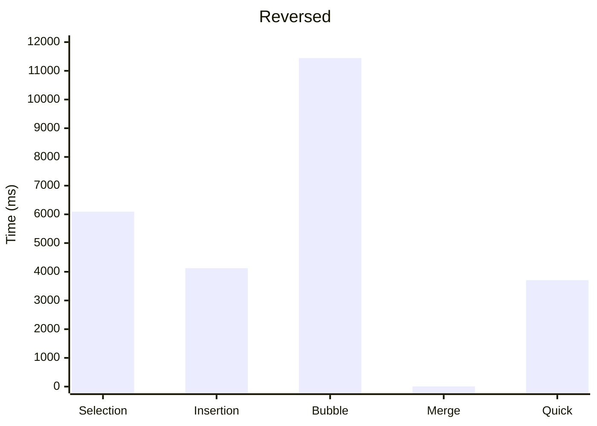
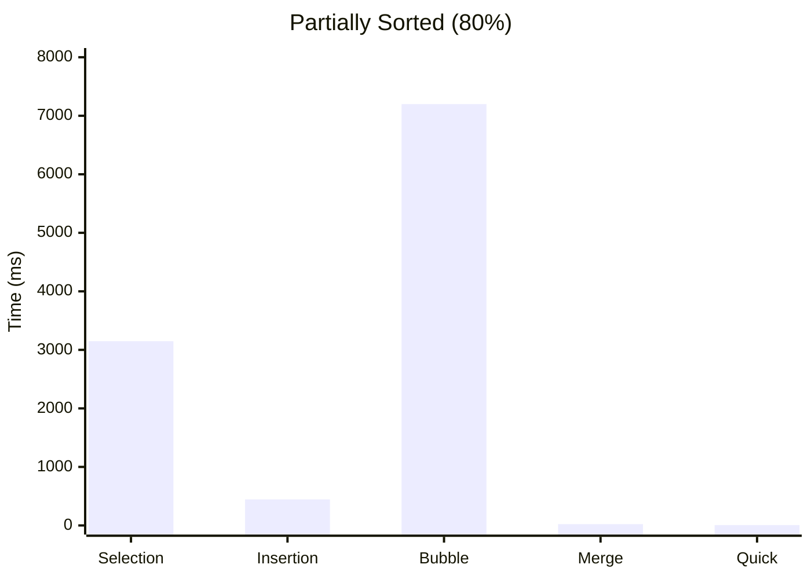
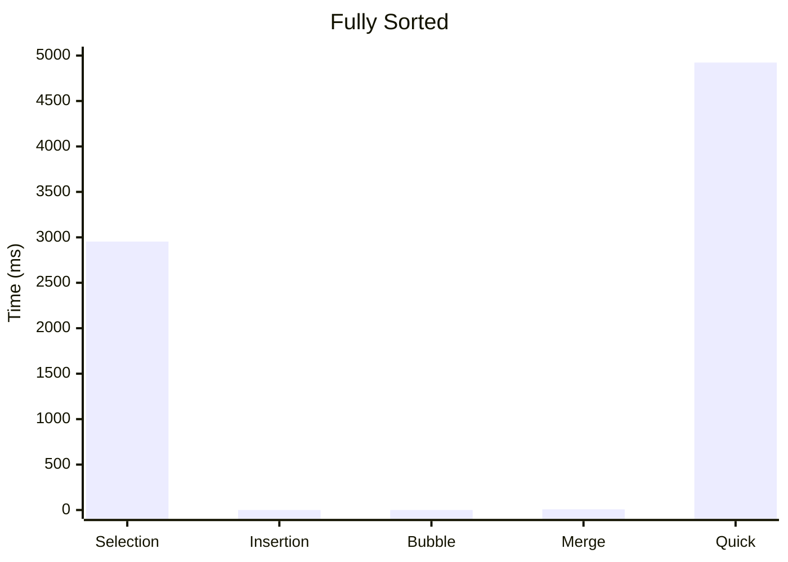

# Benchmark-Algorithms-Sorting

نشاط عملي: التحليل والمقارنة التطبيقية لأداء خوارزميات الترتيب (Java)

## 1. البيانات الشخصية

| البند | القيمة |
|---|---|
| اسم الطالب | إلياس خالد مختار العيساوي |
| الرقم الجامعي (رقم القيد) | 3167118 |
| رقم الشعبة | ______ |

## 2. جدول نتائج الأزمنة (بالميكروثانية µs)

حجم المصفوفة: N = 100,000 عنصر. القياس بـ `System.nanoTime()` مقسومًا على 1000، ويشمل زمن الترتيب فقط (بدون زمن النسخ).

| الخوارزمية | غير مرتبة (Random) | مرتبة عكسيًا | مرتبة جزئيًا (80%) | مرتبة تمامًا |
|---|---:|---:|---:|---:|
| Selection Sort | 5,948,296 µs | 6,094,011 µs | 3,147,915 µs | 2,954,126 µs |
| Insertion Sort | 2,063,745 µs | 4,124,672 µs | 445,463 µs | 97 µs |
| Bubble Sort | 19,755,139 µs | 11,443,752 µs | 7,199,923 µs | 53 µs |
| Merge Sort | 137,160 µs | 6,400 µs | 22,462 µs | 8,041 µs |
| Quick Sort | 38,335 µs | 3,708,005 µs | 6,368 µs | 4,923,412 µs |

> الأرقام تختلف قليلًا من جهاز لآخر ومن تشغيل لآخر (تأثير JIT والمعالج).

## 3. الرسم البياني (الزمن بالميلي ثانية ms)

### الحالة العشوائية

### الحالة العكسية

### الحالة الجزئية (80%)

### الحالة المرتبة تمامًا

## 4. تحليل ومناقشة النتائج

### 4.1 مقارنة O(N²) مع O(N log N)

خوارزميات Selection وInsertion وBubble تنفذ حوالي N² / 2 عملية، أي حوالي 5 مليارات عملية عند N = 100,000، أما Merge وQuick فتنفذان حوالي N·log₂N، أي حوالي 1.7 مليون عملية. وهذا ما ظهر في الحالة العشوائية:

- Merge Sort أنهى الترتيب في 137 ms، بينما Bubble Sort احتاج حوالي 19.7 ثانية (أبطأ بنحو 144 ضعفًا).
- Quick Sort أنهى الترتيب في 38 ms، ب
