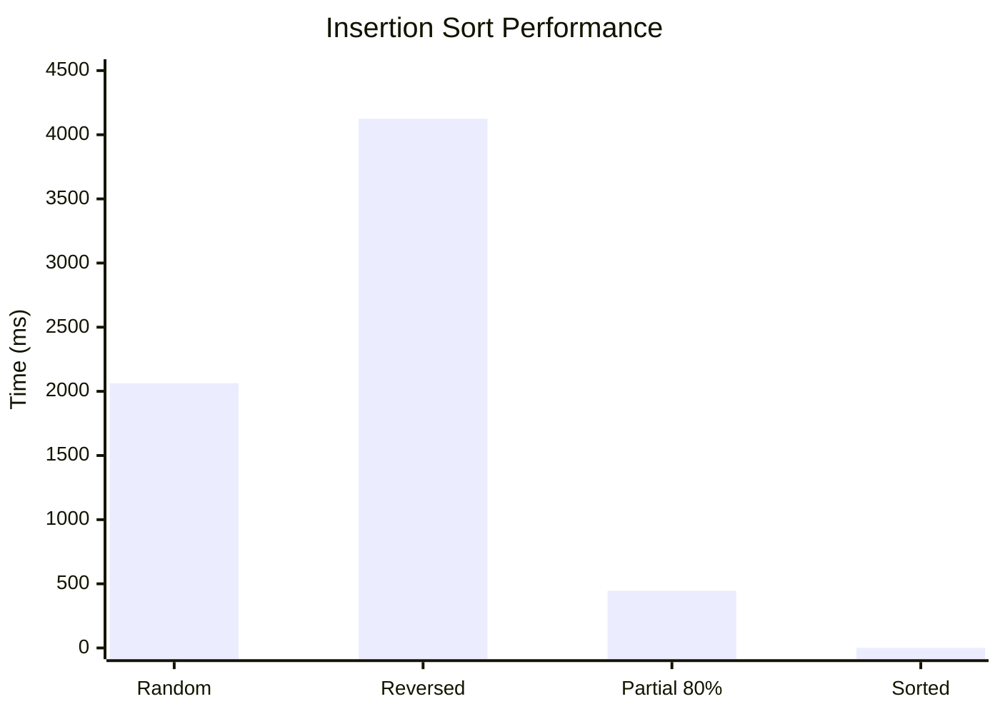

# Benchmark-Algorithms-Sorting

## 1. البيانات الشخصية

| البند | القيمة |
|---|---|
| اسم الطالب | إلياس خالد مختار العيساوي |
| الرقم الجامعي (رقم القيد) | 3167118 |
| رقم الشعبة | ______ |

---

## 2. نتائج خوارزمية Insertion Sort

**حجم المصفوفة:** N = 100,000 عنصر

**وحدة القياس:** الميكروثانية (µs) والميلي ثانية (ms).

| حالة المصفوفة | الزمن (µs) | الزمن (ms) |
|---|---:|---:|
| غير مرتبة (Random) | 2,063,745 | 2063.745 |
| مرتبة عكسيًا (Reversed) | 4,124,672 | 4124.672 |
| مرتبة جزئيًا (80%) | 445,463 | 445.463 |
| مرتبة تمامًا (Fully Sorted) | 97 | 0.097 |

---

## 3. الرسم البياني لنتائج Insertion Sort

---

## 4. تحليل النتائج

- **المصفوفة غير المرتبة (Random):** استغرقت الخوارزمية 2063.745 ms.
- **المصفوفة المرتبة عكسيًا (Reversed):** سجلت أعلى زمن، وهو 4124.672 ms، لأن العناصر تحتاج إلى عدد كبير من عمليات النقل.
- **المصفوفة المرتبة جزئيًا (80%):** استغرقت 445.463 ms، وهو أقل من زمن المصفوفة العشوائية.
- **المصفوفة المرتبة تمامًا (Fully Sorted):** سجلت أقل زمن، وهو 0.097 ms، لأن الخوارزمية تحتاج إلى المرور على العناصر دون نقلها.

---

## 5. التعقيد الزمني

| الحالة | التعقيد الزمني |
|---|---|
| أفضل حالة | O(N) |
| متوسط الحالة | O(N²) |
| أسوأ حالة | O(N²) |

- **أفضل حالة:** عندما تكون المصفوفة مرتبة تصاعديًا.
- **متوسط الحالة:** عندما تكون العناصر بترتيب عشوائي.
- **أسوأ حالة:** عندما تكون المصفوفة مرتبة عكسيًا.

---

## 6. الاستنتاج

توضح النتائج أن خوارزمية Insertion Sort مناسبة للمصفوفات الصغيرة أو المرتبة مسبقًا، حيث يكون أداؤها سريعًا جدًا. لكنها تصبح بطيئة عند ترتيب عدد كبير من العناصر عكسيًا، بسبب زيادة عمليات المقارنة ونقل العناصر.

**ملاحظة:** قد تختلف الأزمنة حسب مواصفات الجهاز، وإصدار Java، وظروف تنفيذ البرنامج.
